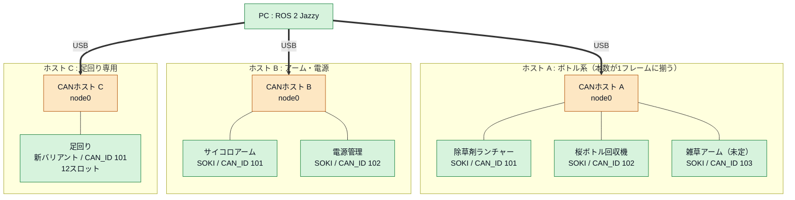
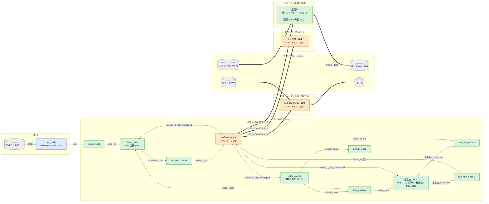
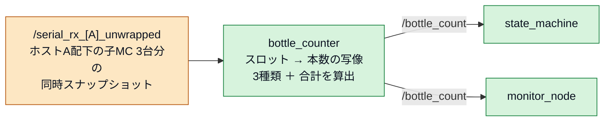
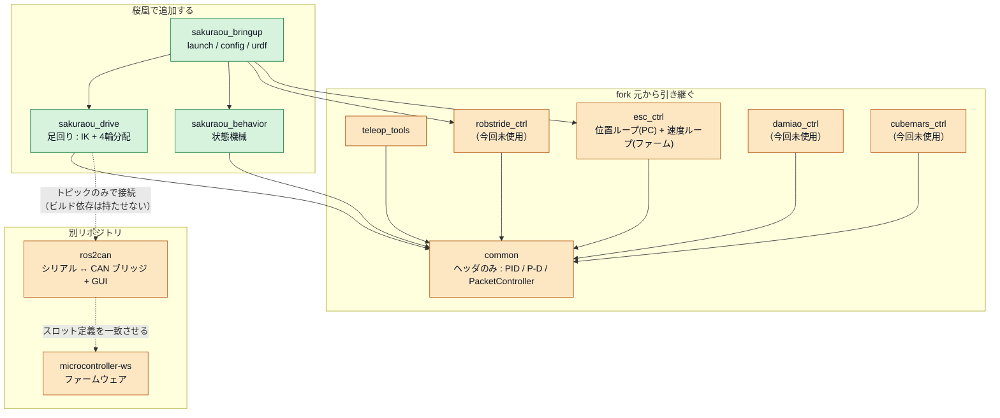
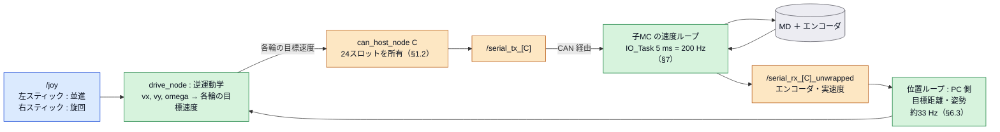
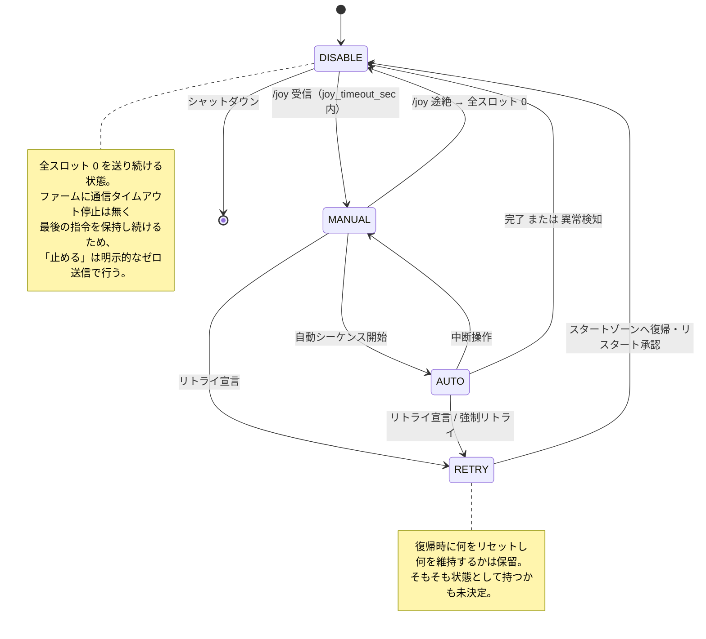
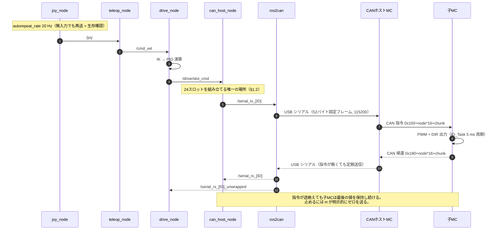

# 桜凰 設計メモ

関西春ロボコン2027・立命館 桜凰のソフトウェア設計メモ。
構成図・決定事項・保留事項・調査の結果をまとめたもの。決まっていないことは「未決定」と明記してある。
fork 元は [rrst-ros2-ws](https://github.com/RRST-NHK-Project/rrst-ros2-ws)（`sample/rrst-ros2-ws`）。
トピック名・型・周期は fork 元の実装に合わせてあるので、変更したらここも直す。

| 項目 | 内容 |
|:---|:---|
| OS / ROS | Ubuntu 24.04 LTS / ROS 2 Jazzy |
| PC ↔ CANホストMC | `ros2can`（USB シリアル 115200 baud, `[0xAA][DEVICE_ID][LENGTH][int16×24 BE][XOR]` の52バイト固定） |
| CANホストMC ↔ 子MC | CAN 1 Mbps。指令 `0x100+node*16+chunk` / 帰還 `0x180+node*16+chunk`、DLC=8、int16×4/フレーム(BE) |
| 子MC ↔ アクチュエータ/センサ | **CANバス上には子MCしか居ない。** MD(PWM+DIR) / エンコーダ(A/B) / SW / サーボは各子MCのピンに直結 |

## 作図規約

| 記法 | 意味 |
|:---|:---|
| 実線矢印 + ラベル | ROS 2 トピック（pub → sub の向き） |
| 破線矢印 | 直接通信しない依存・整合制約 |
| 太矢印 | 物理接続（USB / CAN） |
| `[( )]` | ROS ノードではない物理デバイス |

> **DEVICE_ID と CAN_ID は別物**。`DEVICE_ID` はシリアルフレームの宛先（`serial_tx_<DEVICE_ID>`、ファームの `config.hpp`）、
> `CAN_ID` は CAN バス上の子ノード（101–104）。図中では前者を基板名の横に、後者をアクチュエータの横に書く。

---

## スロットとは

**1スロット = `int16` 1個 = 2バイト。** ファームの `Tx_16Data[24]` / `Rx_16Data[24]` そのもの。

```
シリアルフレーム: [0xAA][DEVICE_ID][LENGTH][int16 × 24 (BE)][XOR]  = 52バイト固定
CAN フレーム:     DLC = 8 = int16 × 4  → 4スロット/フレーム
```

値の意味は割り当て次第。

| 用途 | 中身 |
|:---|:---|
| MD | 符号 = 方向、絶対値 = PWM デューティ（±`MD_PWM_MAX`、8bit なら ±255） |
| サーボ | 角度 [deg] |
| エンコーダ | カウント（int16 なので ±32767 で折り返す） |
| SW | 0 / 1 |
| スケール付きの物理量 | LSB を決めて整数化（例: 0.001 rad/LSB） |

**32767 を超える値は2スロット使う。** int32 を上位・下位に分けて送る
（fork 元の `robstride_ctrl/include/robstride_ctrl/slot_layout.hpp` が「`1,2: target (int32、1 が上位)`」）。
足回りで目標速度を送るなら、**何 rad/s を 1 とするかのスケールを決めること**。

**エンコーダが折り返すのはこれが理由。** だから `ros2can` が `_unwrapped`（Int32MultiArray）を別トピックで出す。

**スロット数は4の倍数にするとCANフレームに無駄が出ない。**

| スロット/ノード | CANフレーム数 | 無駄 |
|---:|---:|:---|
| 5（SOKI / MES） | 2（4 + 1） | 2フレーム目で3スロット分が空き |
| 12（ホスト C） | 3（4 + 4 + 4） | なし |

---

## 色分けの凡例

図中のノードは「誰が決めた仕様か」で塗り分けている。

| 色 | 区分 | 意味 | 変えるとどうなるか |
|:---|:---|:---|:---|
| 🟦 青 | **ROS 2 で固定** | ROS 2 Jazzy 本体・標準パッケージ・標準 msg が決めている | 変更できない |
| 🟧 橙 | **fork 元で固定** | `rrst-ros2-ws` / `ros2can` / ファームウェアが決めている | ファームや `ros2can` 側も直さないと通信できない |
| 🟩 緑 | **桜凰で決める** | 自由に設計できる | 影響はこのリポジトリ内に収まる |
| ⬜ 灰 | 物理デバイス | 基板・モータ・コントローラ | 回路図・配線の話 |

### 🟦 ROS 2 で固定されているもの

| 要素 | 根拠 |
|:---|:---|
| `joy_node` とパラメータ `autorepeat_rate` / `deadzone` | ROS 2 公式 `joy` パッケージ |
| トピック名 `joy` | 同パッケージの既定 |
| 型 `sensor_msgs/Joy`, `std_msgs/Int16MultiArray`, `Int32MultiArray`, `Float32MultiArray`, `Float64`, `sensor_msgs/JointState` | ROS 2 標準メッセージ |
| 相対名 / 絶対名の解決ルール、namespace、QoS | ROS 2 の仕様 |
| `ROS_AUTOMATIC_DISCOVERY_RANGE` | ROS 2 Jazzy の環境変数 |
| フレーム名 `map` / `odom` / `base_link` | REP-105 |
| `colcon` / `package.xml` / `CMakeLists.txt` の作法 | ament |

### 🟧 fork 元で固定されているもの

| 要素 | 根拠（fork 元のファイル） |
|:---|:---|
| `serial_tx_<ID>` / `serial_rx_<ID>` / `_unwrapped` / `_zeroed` の名前と型 | `ros2can/ros2can/ros_backend.py` |
| 24 × int16 の固定長フレーム（`DATA_SIZE = 24`） | `common/include/common/Ros2CanPacketController.hpp` |
| `NODE_COUNT = 4` / `SLOTS_PER_NODE = 5` | 同上 ＋ ファーム `config.hpp` ＋ `device_profiles.py` |
| グローバル index の計算式 | 同上 |
| CAN_ID = 101–104 | 同上のコメント |
| 「全スロット 0 = 安全な既定値」という規約 | ros2can `AGENTS.md`。**自動停止ではない**（§1.2） |
| RobStride のスロット割り当て（mode_word / target / vel_limit） | `robstride_ctrl/include/robstride_ctrl/slot_layout.hpp`。**今回未使用**（CAN直結アクチュエータ用） |
| `robstride/motorN/cmd` `/state` と `Float32MultiArray` | `robstride_ctrl/src/*.cpp`。**今回未使用** |
| `common` の PID / PacketController の API | `common/include/common/` |
| `ros2can` を別ターミナルで `--nogui` 起動する運用 | `robstride_ctrl/launch/robstride_ctrl.launch.py` のコメント |
| シリアルフレーム `[0xAA][DEVICE_ID][LENGTH][int16×24 BE][XOR]`（52バイト固定, 115200 baud） | `ros2can/frame_codec.py` ⇔ ファーム `serial_task.cpp` |
| CAN ID 指令 `0x100+node*16+chunk` / 帰還 `0x180+node*16+chunk`（DLC=8, int16×4/フレーム BE） | ファーム `can_task.cpp` |
| 子MCのスロット割り当て（SOKI: SERVO1-3 + MD1-2 ⇔ SW1-3 + ENC1-2 / MES: MD1-2 ⇔ SW1 + ENC1-2） | ファーム `frame_data.hpp` ⇔ `device_profiles.py` |
| SERVO⇔SW、MD⇔ENC のピン共有（`MULTIn` / `ENCn_MD` でコンパイル時に固定） | 同上。CAN 経由では切替不可 |
| `CAN_NODE_COUNT` は**ホスト自身を含む**実接続ノード数に一致させる（不一致で ACK エラー → 約40msで Bus-Off） | ros2can `config.hpp` の実測コメント |
| 1ホストあたり子MC は3台まで（5スロット構成、`4 × 5 = 20 <= 24`） | 同上（`CAN_NODE_COUNT * CAN_SLOTS_PER_NODE <= 24`） |
| 同一バス上の `CAN_SLOTS_PER_NODE` は全ノードで揃える | ホストが24スロットを一律分割するため。混在自体は可能（系統一覧の節） |
| **ファームに通信タイムアウト停止が無い**（最後の指令を保持し続ける） | `docs/internals.md` 6章 |
| 同じ指令トピックに複数の送信元がいると後勝ち | ros2can `AGENTS.md` |
| ROSコールバックの処理上限（GUIモードは全デバイス合計で約100/s、遅れ最大190ms） | ros2can `AGENTS.md`（2026-09-12 実測）。§6.3 |
| 汎用IOノードに制御則が無い（MD は duty パススルー） | ファーム `pin_ctrl_task.cpp`。§6.1 |
| `IO_Task` 5 ms / `canTask` 5 ms / `serialTask` TX 20 ms | `docs/internals.md` 3.1。§6.3 |
| driver / teleop / monitor の3分割というノード構成パターン | 各 `*_ctrl` パッケージ |

### 🟩 桜凰で決めるもの

| 要素 | 備考 |
|:---|:---|
| パッケージ名と分割（`sakuraou_*`） | 命名規約だけ揃える |
| 足回りの駆動方式・輪数・逆運動学 | **未決定** |
| 足回り用基盤の端子構成 | 自作基板 |
| 状態機械の状態名と遷移条件 | ただし DISABLE の意味は橙 |
| 制御周期 | 50 Hz は fork 元の既定値であって必須ではない |
| PID ゲイン | 橙のノードの中にある緑の値 |
| ボタン配置 | fork 元も「`ros2 topic echo /joy` で要確認」としている |
| ホスト3台構成と系統の割り当て | **決定**（系統一覧の節）。配置変更は本数の整合に直結する |
| 各ホストの `DEVICE_ID` | **未決定**。ホスト間で重複させないことだけ確定 |
| `CAN_ID` の具体値 | バス内で一意ならよい。両バスとも 101-103 で揃える想定 |
| 電源管理をCANノードにするか | **未決定**。不要ならホストBは子MC 2台 |
| 足回り用基盤の `BOARD_VARIANT` の中身 | 新規追加が必要（§7）。スロット割り当ては案の段階 |
| 子MC へ送るのは duty か目標速度か | 速度ループを子MC に置くなら目標速度（§7.2） |
| サイコロの目の取得手段 | **未決定**。カメラ / 機構の動作量 / 手動入力（競技ルールの節） |
| 満開宣言の合図手段 | 表示 / 音 / 動作。スロットを1つ確保する |
| `serial_tx` の送信周期 | 実機で実測して決める（§1.2） |
| スロット → 本数の写像 | 種類と子MCは 1:1 でない（§1.3）。**未決定** |
| `valid` のタイムアウト時間 | 帰還フレームの定期送信周期から決める |
| 満載判定の閾値とヒステリシス幅 | 競技ルール次第 |
| トピック名の先頭スラッシュをどちらに統一するか | fork 元が不統一なので、どちらでも可 |

---

## 系統一覧

| 系統 | 決定状況 | 本数トピックとの関係 | 担当 |
|:---|:---|:---|:---|
| 足回り | ある程度決定 | — | **ホスト C（専用）** |
| 電源管理 | ある程度決定 | — | **ホスト B**（CANノード化は未定） |
| サイコロアーム | 存在は確定、中身未定 | — | **ホスト B** |
| 除草剤ランチャー | 存在は確定、中身未定 | 除草剤ボトル本数 | **ホスト A** |
| 桜ボトル回収機 | 存在は確定、中身未定 | 桜ボトル本数 | **ホスト A** |
| 雑草アーム | **未定** | 雑草ボトル本数 | **ホスト A**（確定時） |

基板は **SOKI が主力**。足回りだけ専用基板（新 `BOARD_VARIANT`、§7）。

### ホスト構成（決定）



| ホスト | 子MC | `CAN_NODE_COUNT` | `CAN_SLOTS_PER_NODE` | プロファイル |
|:---|:---|---:|---:|:---|
| A | 除草剤 / 桜回収 / 雑草（SOKI） | 4 | 5 | 標準 `make_can_host_profile` |
| B | サイコロ / 電源（SOKI） | 3 | 5 | 標準 |
| C | 足回り（新バリアント） | 2 | **12** | 手書き（単一ノードなので単純） |

**`CAN_NODE_COUNT` はホスト自身(node0)を含む実接続ノード数。** 実接続と合わないと
存在しないノード宛の ACK エラーで**約40msでBus-Off** する（ros2can `config.hpp` の実測コメント）。
「対応可能な最大数」を書いておく運用はできない。

### スロット予算

`CAN_NODE_COUNT × CAN_SLOTS_PER_NODE <= 24`（超えると `#error`）。
スロット数は**バス単位**で決まるので、専用バスにすれば1ノードで多くのスロットを取れる。

| ホスト | 計算 | 足回りの帰還スロット |
|:---|:---|:---|
| A（SOKI 統一） | 4 × 5 = 20 | — |
| B（SOKI 統一） | 3 × 5 = 15 | — |
| C（足回り専用） | 2 × 12 = 24 | ENC×4 ＋ **空き8** |

足回りを A/B に同居させると帰還の空きが**1枠**しか残らず、リミットSW・原点センサ・電流値・診断を
後から足せない。**ホスト C を立てた理由がこれ。**

### バリアント混在の条件

> ros2can `AGENTS.md` の「異なる `BOARD_VARIANT` を同一CANバスに混在させる構成は現状未対応」は、
> **GUI が自動でプロファイルを作らない**という意味であり、物理層の制約ではない。
> 実装済みの前例として `make_can_host_with_foc_node_profile()`（XIAO ホスト配下に STM32 の FOC ノードを
> 1台混在させる）があり、その既定値は実機構成に合わせてある。

**本当の条件は、同一バス上で `CAN_SLOTS_PER_NODE` が揃っていること。** ホストが24スロットを一律に分割するため。

| バリアント | スロット/ノード | 同居 |
|:---|---:|:---|
| `BOARD_SOKI` | 5 | ✓ |
| `BOARD_MES` | 5 | ✓ |
| `BOARD_SS` | **9** | **✗ 専用バスが必要** |

ソレノイドバルブを使う系統が出てきたら `BOARD_SS` になり、そこだけ別バスになる。

### 複数ホストで増える注意点

| 項目 | 内容 |
|:---|:---|
| USB ポート | ホスト1台につき1本。PC は 115200 で開き、**フレームの `DEVICE_ID` で識別**する（`serial_link.probe_port()`） |
| `DEVICE_ID` | ホスト間で重複させない。重複すると同じトピックに2台が相乗りする |
| `CAN_ID` | **バスが別なら 101 から振り直してよい**（バス内で一意であればよい） |
| `serial_tx` の所有者 | **ホストごとに1ノード**（§1.2）。`can_host_node` を3つ立てる |
| 処理負荷 | GUIモードは全デバイス合計で約100コールバック/s。**3ホストなら1台あたり約33Hz**（§6） |

---

## 競技ルールから来る制約

`Docs/関西春ロボコン2027_ルールブック.pdf`（ver.1.0.0）から、ソフトに直接効くものを抜き出す。

| 項目 | 値 |
|:---|:---|
| 競技時間 | 3分（セッティング1分） |
| オブジェクト | 桜ボトル15本 / 除草剤ボトル5本 / 雑草ボトル3本 / サイコロ1個、各150 g |
| 初期制限 | 700 mm 立方 |
| 展開制限 | 1000 mm 立方 |
| 重量 | 20 kg 以下（エアタンク除く） |
| 電源 | 公称 24 V 以下、回路内 42 V 以下 |

### 把持上限はサイコロの目（動的に変わる）

> 5.4 「サイコロ」の目の数より多い本数のペットボトルを把持した場合 → 違反・強制リトライ

**上限は固定値ではない。** ロボット自身がサイコロの目を変えるため（3.5.2、20点）、試合中に変わる。
桜・除草剤・雑草はすべてペットボトルなので、**3種類の合計**が判定対象。§1.3 の `total` がこれにあたる。

**現在のサイコロの目をどう知るかは未決定。** カメラで読む / 機構の動作量から確定させる / 手動入力のいずれか。

### 非常停止はハードの電源遮断

> 9.2.1 押すことで全ての駆動用電源が遮断される必要があります
> 9.2.2 黄色単色の背景と赤色のプッシュロックターンリセット式スイッチ

**ソフトの E-STOP ではない。** ただし以下はソフト要件として残る。

- 9.4 異常発生時に制御不能になり危険な動きをしないこと
- 9.5 **電源が失われても、投入順序に関係なく暴走しないこと**
  → 電源断から復帰したとき、子MC が前の duty を保持したまま動き出さないことを確認する（§6.1）

### リトライが何度でも起きる

宣言と審判の承認でリトライ（4.1–4.3）。非常停止で止めてスタートゾーンへ運び、リスタートにも宣言と承認が要る。
リトライ中は機体に触れてよく、動作も認められる（4.5）。

**状態機械に `RETRY` 状態が要る。** 何をリセットし何を維持するかは §4 の図に書いた。

### 共通ゾーンの配置条件

- ゾーン N に置くには、**N 未満の全ゾーンに桜ボトルが置かれている**必要がある（ゾーン1は例外）
- **自コートの全雑草ボトルの底面が完全に接地している**場合のみ配置できる
- 相手は除草剤ボトルを投擲して雑草ボトルを倒してくる（倒れていると −15点/本）

**「置ける / 置けない」が相手の行動で動的に変わる。** 状態機械は進捗カウンタと雑草の状態の両方を条件に持つ。

### 満開宣言はロボットが合図する

> 3.5.5 「満開」を達成した状態で審判がロボットの合図を確認した時点で「満開宣言」が認められます

**合図用の出力が要る**（表示・音・動作のいずれか）。ソフトから出すので、スロットを1つ確保しておく。

---

## 1. 全体構成図



### 1.1 インタフェース定義表

| トピック | 型 | pub | sub | 周期 |
|:---|:---|:---|:---|:---|
| `/joy` | `sensor_msgs/Joy` | `joy_node` | `teleop_node` | 20 Hz（無入力でも再送） |
| `/cmd_vel` | `geometry_msgs/Twist` | `teleop_node` | `drive_node` | 要実測（§1.2） |
| `/robot_state` | 自作 | `state_machine` | `drive_node`, 各系統ノード | 変化時 |
| `/<系統>/slot_cmd` | `std_msgs/Int16MultiArray` 等 | 各系統ノード | 担当ホストの `can_host_node` | 変化時 |
| `/serial_tx_<ID>` | `std_msgs/Int16MultiArray`（24要素） | **その `DEVICE_ID` の `can_host_node` だけ**（§1.2） | `ros2can` | 要実測（§1.2） |
| `/serial_rx_<ID>` | `std_msgs/Int16MultiArray` | `ros2can` | `can_host_node` | 受信次第 |
| `/serial_rx_<A>_unwrapped` | `std_msgs/Int32MultiArray` | `ros2can` | `bottle_counter`, ボトル系の系統ノード | 受信次第 |
| `/serial_rx_<B>_unwrapped` | `std_msgs/Int32MultiArray` | `ros2can` | `drive_node`, サイコロ/電源の系統ノード | 受信次第 |
| `/serial_rx_<ID>_zeroed` | `std_msgs/Int32MultiArray` | `ros2can` | `drive_node` | 受信次第 |
| `/bottle_count` | `sakuraou_interfaces/BottleCount`（自作） | `bottle_counter` | `state_machine`, `monitor_node` | 変化時 |

> **トピック名の先頭スラッシュが fork 元で統一されていない**。`robstride_ctrl` と `ros2can` は相対名（`serial_tx_1`）、
> `esc_ctrl` は絶対名（`/serial_tx_1`）。既定の名前空間では一致するが、ノードに namespace を付けた瞬間に
> 相対名だけが `/<ns>/serial_tx_1` へずれて繋がらなくなる。桜凰では**相対名に統一する**（下の表は既定名前空間での解決後の名前）。

> エンコーダのカウンタは int16 で折り返すため、**位置を使う側は `_unwrapped`（Int32）を購読する**。
> 原点合わせ済みの値が欲しい場合は `_zeroed`。生の `/serial_rx_<ID>` は折り返すので位置制御に使わない。

### 1.2 `serial_tx_<ID>` の所有権

**`/serial_tx_<ID>` を publish するノードは1つだけにする。**

24スロットのフレームは CANホスト1台につき1本しかなく、publish は**配列全体の置き換え**になる。
複数のノードが同じトピックに publish すると、担当スロットを分けていても
**後に届いた配列が全スロットを上書きする**。

fork 元の `robstride_driver_node` などは各ノードが直接 `serial_tx` を publish している。
あれは1系統1デバイスだったので成立していた流儀で、
**CANホスト1台に足回りとボトル機構が同居する今回の構成では成立しない。**

ros2can の `AGENTS.md` に、高頻度でゼロを送り続ける送信元が別の送信元の指令を上書きして
実質無効化した事例が記録されている（「送信しているのに効かない」ときは、より高頻度の上書きを疑う）。

よって `can_host_node` が24スロットを所有し、各ノードは自分の担当スロットの値だけを個別トピックで渡す。
`Ros2CanPacketController`（`common/`）はこのノードの中だけで使う。

**ホストを複数積むので、`can_host_node` は `DEVICE_ID` ごとに1つ立てる。**
1ノードが複数のフレームを持つ形にはしない（どのスロットがどのホストのものか混ざる）。

```
drive_node          --/drive/slot_cmd------>  can_host_node (B) --/serial_tx_<B>--> ros2can
dice_arm_node       --/dice/slot_cmd------->  can_host_node (B)
herbicide_node      --/herbicide/slot_cmd->   can_host_node (A) --/serial_tx_<A>--> ros2can
sakura_node         --/sakura/slot_cmd---->   can_host_node (A)
weed_arm_node       --/weed/slot_cmd------>   can_host_node (A)
```

所有者が `DEVICE_ID` 単位なので、**系統ノードを別ホストへ移すときは publish 先を変えるだけ**で済む。
系統ノード側にスロット番号を持たせないこと（持たせると移動のたびに書き換えになる）。

#### 送信周期は実測して決める

GUIモードの実測（2026-09-12、ros2can `AGENTS.md`）で
**1デバイスあたり約31指令/s、指令の遅れ最大約190ms、`serial_tx` 合計 約310msg/s**。
GUIモードは 10ms の QTimer から `rclpy.spin_once(timeout_sec=0)` を呼び、
1回で処理するコールバックが1つだけなのが原因。

`--nogui` での実測値は記録が無い。**足回りの 50 Hz を前提にせず、実機で測ってから決める。**
QoS depth を 1 にして古い指令を溜めないのも対策になる。

#### 止めるときは明示的にゼロを送る

**ファームには通信タイムアウトによる自動停止が無く、最後の指令を保持し続ける**
（ros2can `docs/internals.md` 6章）。PC 側が落ちてもモータは回り続ける。
停止は PC 側の E-STOP か、ゼロ指令の明示的な送信で行う。

`can_host_node` は、担当ノードからの指令が途絶えたらそのスロットをゼロで埋める責任を持つ。
fork 元の `ps4_teleop_node` が `/joy` の途絶を `joy_timeout_sec` で見ているのと同じ考え方。

### 1.3 保持ボトル本数

**本数の種類と子MCは 1:1 とは限らない。** 1つの子MCが複数種類のセンサを持つこともあれば、
1種類の本数が複数の子MCにまたがることもある。
したがって設計は「MC単位」ではなく **「スロット → 本数」の写像** で定義する。

#### 同じCANホスト配下なら整合した合計が作れる

CANホスト1台につき `/serial_rx_<ID>` は**1本**で、その24スロットが子MC全台へ分配されている
（`グローバル index = node × SLOTS_PER_NODE + local_index`）。
つまり**同じホスト配下のセンシングは1つのメッセージで同時に届く**。

よって `bottle_counter` が `/serial_rx_<ID>_unwrapped` を直接購読し、スロット写像から3種類とも算出すれば、
**1メッセージ = 1スナップショット**になり、合計は常に整合する。



**系統ノードを本数算出の経路に挟まない。** 挟むとトピックを1段増やして非同期にし、
せっかく揃っているスナップショットをわざわざ崩すことになる。
機構の状態によって数え方が変わる場合だけ、その状態を `bottle_counter` に渡す。

> 同一フレーム内でも、ノードごとの値は**最大1CAN周期分だけ鮮度がずれる**。
> ホストが各子MCの帰還を非同期に受けてバッファへ溜め、まとめてシリアル送信するため。
> ただしズレの上限はホストのCAN周期で決まり、ROSトピックを別々に受ける場合よりはるかに小さい。

#### 整合の条件は「ボトル系が同じホスト配下にいること」

ホストは複数台積む方針だが、**ボトル系3系統をホスト A に寄せる割り当て**（系統一覧の節）なら、
3種類とも `/serial_rx_<A>_unwrapped` の1フレームから取れるので整合は保てる。

| 配置 | `total` の定義 | 整合 |
|:---|:---|:---|
| ボトル系が1ホストに収まる（**決定済みの構成**） | そのフレームから算出した和 | **常に整合** |
| ボトル系がホストを跨ぐ | 各ホストの最新値の和 | 整合しない。ホストごとに鮮度を見る |

**系統を別ホストへ移すと、この表の行が変わる。** 配置変更は本数の整合に直結するので、
移すときは `total` の定義と `valid` の数を見直す。

```
# sakuraou_interfaces/msg/BottleCount
std_msgs/Header header     # 算出に使ったフレームの受信時刻
uint8 sakura
uint8 herbicide
uint8 weed
uint8 total                # 単一ホストなら整合した合計
bool  valid                # ホストAのフレームが timeout 内に届いているか
```

ボトル系がホストを跨ぐ配置に変えた場合は、`valid` をホストごとに増やし、
`total` の定義を「最新値の和」に変える。

#### 古い値が混ざった合計が一番危ない

シリアルが切れても `bottle_counter` は最後に受けた本数を保持し続けるため、
**合計はもっともらしい値のまま流れ続ける**。止まったことに気付けないのが問題なので、
フレームの最終受信時刻を見て `valid` を落とす。

ROS 2 のメッセージには送信時刻が入らないので、**到着時刻で判定する**。
fork 元の `ps4_teleop_node` が `/joy` の途絶を `joy_timeout_sec` で見ているのと同じ方法。
ファーム側は**指令が無くても帰還フレームを定期送信し続ける**ので、届かなくなったこと自体が異常の証拠になる。

#### 把持上限はサイコロの目（固定値ではない）

比較対象は**現在のサイコロの目**で、試合中に変わる（競技ルールの節）。
`total` がそれを超えると違反・強制リトライなので、**超えないことが本数管理の目的**。

センサのノイズやカウントの取りこぼしで値は一時的に前後する。閾値をまたいだ瞬間に動作を止めると誤動作するので、
**一定時間超え続けていること**を条件にする、または**ヒステリシス**を入れる（上限で止めて、上限−1 で再開）。

サイコロの目は `state_machine` が保持し、`bottle_counter` は本数だけを出す（判定は購読側）。
目の取得手段が未決定なので、**暫定で手動入力の経路を用意しておく**と実機検証が止まらない。

---

## 2. パッケージ構成図



`robstride_ctrl` / `damiao_ctrl` / `cubemars_ctrl` は **CANバスに直結するアクチュエータ**用。
今回は CAN 上に子MCしか居ないので使わない。消さずに残すのは fork 元との差分を小さく保つため。

**原則**

- `common` は header-only。全パッケージが一方向に依存する（逆向きの依存を作らない）。
- `ros2can` とはトピックだけで繋ぐ。`package.xml` に依存を書かない（別リポジトリなので壊れやすい）。
- 自作 msg/srv を作るなら `sakuraou_interfaces` を別パッケージに切り、定義をそこだけに置く。

---

## 3. 足回りのデータフロー



**ループは2段に分ける。** 速度ループは子MC の `IO_Task`（200 Hz）、位置ループは PC 側（約33 Hz）。
PC 側で速度ループを閉じると、可変な最大190 ms の位相遅れが直接効いて発振する（§6.3）。
位置ループは積分的な性質で遅れに強いので、33 Hz でも成立する。

> **`common/common.hpp` は現状インクルードできない**。中で `common/IK.hpp` を include しているが、
> fork 元にそのファイルが存在しない（現在どのパッケージも `common.hpp` を include していないため気付かれていない）。
> 足回りで IK を書くときは、`PID.hpp` などを個別に include するか、`IK.hpp` を自分で用意する。

スロット番号は `グローバル index = node(0 起点) × SLOTS_PER_NODE + local_index`。
ファームの `config.hpp`（`CAN_NODE_COUNT` / `CAN_SLOTS_PER_NODE`）と
`ros2can/device_profiles.py` のプロファイルと**三者を必ず一致させる**。
ホスト C は手書きプロファイルなので、ここがずれても GUI は警告しない。

---

## 4. 状態遷移図



### RETRY を状態として持つかは電源設計で決まる（保留）

**復帰時に何をリセットし何を維持するかは一旦保留。** 先に決めるべきは電源の構成。

非常停止は**駆動用電源だけ**を遮断する（ルール 9.2.1）。制御用電源（PC・マイコン）を別系統にできるため、
**どちらの構成を取るかで RETRY の扱いが変わる。**

| 電源構成 | RETRY は | 復帰の実体 | 注意 |
|:---|:---|:---|:---|
| 制御電源も一緒に落ちる | **状態ではない** | 再起動 = `INIT` から | 進捗は電源断で消えるので、保持したいなら PC 側に置く |
| 制御電源は生き残る | 状態として持てる | 状態遷移で復帰 | **復帰時の暴走対策が必須**（下記） |

**制御電源が生き残る構成では、復帰の瞬間が危険。** 子MC は駆動電源が無い間も生きていて、
**最後の duty を保持し続ける**（§6.1）。駆動電源が戻った瞬間にその duty で動き出す。
これはルール 9.5「電源が失われても、投入順序に関係なく暴走しないよう設計」に正面から抵触する。

対策は3つ。

1. 駆動電源の喪失を子MC が検知してスロットをゼロにする（ファーム側）
2. PC が非常停止を検知して即ゼロを送る（**検知手段が別途必要**）
3. 制御電源も一緒に落とす（再起動で初期値 0 になる。**最も確実**）

**ソフト設計の論点というより電源設計の論点なので、電源管理系統の仕様と一緒に決める。**

---

汎用IOノード（`MODE_CAN`）には RobStride のような `mode_word` は無い。スロットの値がそのまま
PWM デューティやサーボ角になる。**ゼロが安全側**という規約だけが共通で、止めるのは PC 側の責任。

`DISABLE` へ入る条件は `/joy` の途絶だけでなく、**どのユニットの帰還が途絶えたか**（§1.3 の valid）も含める。

---

## 5. 制御1周期のシーケンス図



---

## 6. ファームウェアの役割と帯域

### 6.1 ファームが持っている機能・いない機能

書き込むのは `xiao-esp32-s3_can2io` 1種類。`config.hpp` の `MODE_*` と `BOARD_VARIANT` で
**コンパイル時に**役割が決まる。GUI の「ファーム生成」が `config.hpp` を書き換えたコピーを
`generated_firmware/<名前>/` に作り、それを PlatformIO で書き込む。

| タスク | 周期 | 仕事 | CANホスト | 子MC |
|:---|---:|:---|:---:|:---:|
| `serialTask` | TX **20 ms** | PCとの52バイトフレーム送受信 | ✓ | — |
| `canTask` | **5 ms** | 24スロットを子ノードへ分配・帰還を集約 | ✓ | ✓ |
| `IO_Task` | **5 ms** | 自分のピンの PWM / サーボ / エンコーダ / SW | ✓ | ✓ |

**子MC には `serialTask` が無い**（PC と直接話さない）。`loop()` は1秒 delay するだけ。

**持っている機能** — PWM生成（20 kHz / 8 bit）、DIR出力、サーボのパルス幅生成（50 Hz / 14 bit）、
エンコーダの PCNT カウント、SW の digitalRead、CAN の分配と集約、52バイトフレームの組み立てと XOR 検査、
起動時の出力初期化、「全ゼロ = 安全な既定値」の規約。

**持っていない機能** — **制御則が一切ない。** MD は duty のパススルー。

```cpp
int md1 = constrain((int)CanIoRxData[3], -MD_PWM_MAX, MD_PWM_MAX);
digitalWrite(MD1D, md1 > 0 ? HIGH : LOW);
ledcWrite(0, abs(md1));
```

PID は `robomas.cpp` / `cubemars.cpp`（専用アクチュエータモード）にしかなく、MD の経路には無い。
**ウォッチドッグ／タイムアウトのフェイルセーフも無い**（`docs/internals.md` 6章）。

### 6.2 PC 側に回せる処理の境界

| | 内容 |
|:---|:---|
| **回せる** | 位置制御ループ、逆運動学、オドメトリ、状態機械、シーケンス、本数カウントと上限比較、ゼロ指令による停止 |
| **回せない** | PWM・サーボのパルス生成、エンコーダの PCNT カウント、CAN の分配、5 ms 周期のピン更新 |

### 6.3 帯域 — PC側ループは構造的に遅い

ファーム内部は 5 ms（200 Hz）で回っているが、**PC への帰還は `serialTask` の TX 周期 20 ms = 50 Hz**。
指令も同じ経路を通る。往復の内訳:

| 要素 | 時間 |
|:---|---:|
| `IO_Task` | 5 ms |
| `canTask` | 5 ms |
| `serialTask` TX | 20 ms |
| シリアル伝送（52バイト @115200） | 約 4.5 ms |
| ROS 側コールバック | **可変・最大 190 ms**（GUIモード実測） |

**PC 側ループの帯域は構造的に 50 Hz が上限。** さらに GUI モードは 10 ms の QTimer から
`rclpy.spin_once(timeout_sec=0)` を1回呼ぶだけなので、**全デバイス合計で約100コールバック/s**。
3ホスト構成では **1台あたり約33 Hz** まで落ちる。

`--nogui` の実測値は repo に記録が無い。**3ホストで運用するなら早い段階で測ること。**

**これが速度ループを子MC側に置く理由。** PC が送るのは目標速度だけなので、33 Hz で更新できれば足り、
制御品質は子MC の 200 Hz で決まる。PC 側で速度ループを閉じると、可変な190 msの位相遅れが直接効いて発振する。

---

## 7. 足回りの `BOARD_VARIANT`

足回り基盤は既存バリアントのどれとも違うため、新しい `BOARD_VARIANT` を追加する。
手順は ros2can `AGENTS.md`「新しい基板(BOARD_VARIANT)を追加する」の8ステップに従う。

### 7.1 既存バリアントとの違い

| | `BOARD_SOKI` | `BOARD_MES` | 足回り基盤 |
|:---|:---|:---|:---|
| MD | ENC とピン共有 | 専用ピン ×2 | **専用ピン ×2** |
| ENC | MD とピン共有 ×2 | 専用 ×1 ＋ 共有 ×1 | **専用 ×4** |
| スロット/ノード | 5 | 5 | **12**（専用バス） |

**`BOARD_SOKI` は足回りに使えない。** MD と ENC がピン共有（`ENC1_MD` で切替）で、
**MD を使うと同じポートのエンコーダが常に 0 になり、速度フィードバックが原理的に取れない。**
足回り基盤が MD と ENC を別ピンにしているのは、これを避けた設計。

ESP32-S3 の GPIO マトリクスでピン割り当ては自由なので、`defs.hpp` にバリアントの節を足すだけでよい。
物理ピンの並びを既存バリアントに合わせる必要はない。

### 7.2 スロット割り当て（案）

専用バス（`CAN_NODE_COUNT = 2` / `CAN_SLOTS_PER_NODE = 12`）なので余裕がある。

| 方向 | 割り当て | 空き |
|:---|:---|---:|
| 指令 | MD1, MD2, 目標速度1, 目標速度2, 制御モード | 7 |
| 帰還 | ENC1-4, 実速度1, 実速度2, 故障フラグ | 5 |

**速度ループを子MC に置くなら、指令は duty ではなく目標速度になる。** どちらを送るかを
スロット定義の時点で決めること（ファームと `device_profiles.py` の両方に効く）。

### 7.3 実装前に確認すること

- **Z相（`ENC1_X`〜`ENC4_X`）は ros2can のファームが使っていない。** PCNT は A を pulse、B を ctrl に
  割り当てるだけ。原点検出に使うなら自前実装。
- **PCNT は A の両エッジのみを数える2逓倍。** 4逓倍ではないので、分解能は PPR の2倍。速度分解能の見積もりに効く。
- **ESP32-S3 の PCNT ユニット数**で ENC の上限が決まる。ENC×4 を載せるなら要確認。
- **出力ピンは起動時に安全側（OFF/LOW、モータ停止）へ明示的に初期化する**（`AGENTS.md` の要求）。

---

## 付録 A. 起動時の注意

`ROS_AUTOMATIC_DISCOVERY_RANGE=LOCALHOST` を launch で設定する。
既定（SUBNET）だと同じ Wi-Fi の他 PC のノードと繋がる。
fork 元に「2026-10-15 に他 PC の `joy_node` の `/joy` が混ざり、R1 が押す/離すを繰り返した」記録がある。
**`ros2can` も同じ環境変数を付けて起動する**（別ターミナルで起動するため launch に含まれない）。

```bash
ROS_AUTOMATIC_DISCOVERY_RANGE=LOCALHOST ros2 run ros2can ros2can --nogui
```

## 付録 B. 整合性チェックリスト

図を直したら、以下が食い違っていないか確認する。

- [ ] スロット割り当て: `slot_layout.hpp` ↔ ファーム `config.hpp` ↔ `device_profiles.py`
- [ ] `DEVICE_ID`: driver の param ↔ ファーム `config.hpp` ↔ `ros2can` の追加デバイス
- [ ] `CAN_ID`: ファーム ↔ 実機のモータ設定（ID スキャンのスロット 20–23 で確認可）
- [ ] 位置を扱う箇所が `_unwrapped` / `_zeroed` を購読しているか（生 RX は折り返す）
- [ ] `/serial_tx_<ID>` の publisher が `can_host_node` だけか（複数あると後勝ちで壊れる）
- [ ] 指令が途絶えたスロットを PC 側がゼロで埋めているか（**ファームは自動停止しない**）
- [ ] `CAN_NODE_COUNT` が実接続の子MC数と一致しているか（不一致で Bus-Off）
- [ ] 同一バス上の子MCの `BOARD_VARIANT` が揃っているか
- [ ] MD を使うポートの ENC がピン共有で潰れていないか（SOKI の `ENCn_MD`）
- [ ] `serial_tx` の送信周期を実機で測ったか（§1.2、§6.3）
- [ ] `--nogui` のコールバックレートを実機で測ったか（§6.3）
- [ ] 電源断から復帰したとき子MC が前の duty で動き出さないか（ルール 9.5）
- [ ] 把持上限の比較対象が固定値ではなくサイコロの目になっているか

## 付録 C. 命名規約

| 対象 | 規約 | 例 |
|:---|:---|:---|
| パッケージ | `sakuraou_<役割>` | `sakuraou_drive`, `sakuraou_behavior` |
| ノード | 名詞 + 役割、snake_case | `drive_node`, `can_host_node` |
| 指令トピック | `<系統>/<対象>` | `/drive/slot_cmd`, `/cmd_vel` |
| 状態トピック | `<系統>/<対象>` | `/bottle_count`, `/robot_state` |
| シリアル | `serial_tx_<DEVICE_ID>` / `serial_rx_<DEVICE_ID>` | `serial_tx_202` |
| フレーム | REP-105 に従う | `map`, `odom`, `base_link` |
