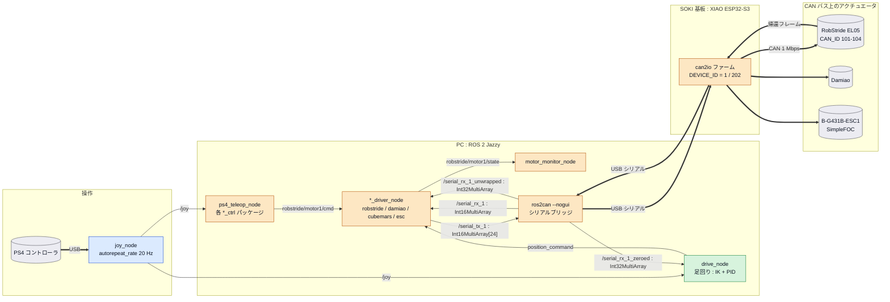
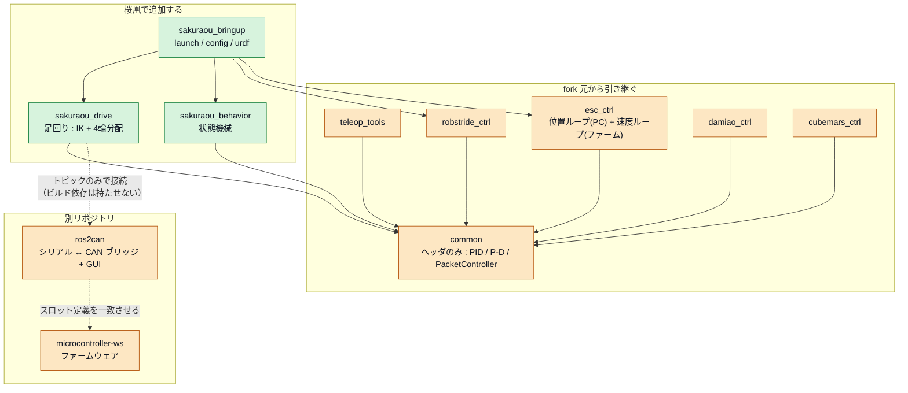
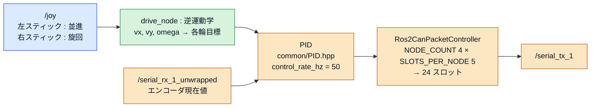
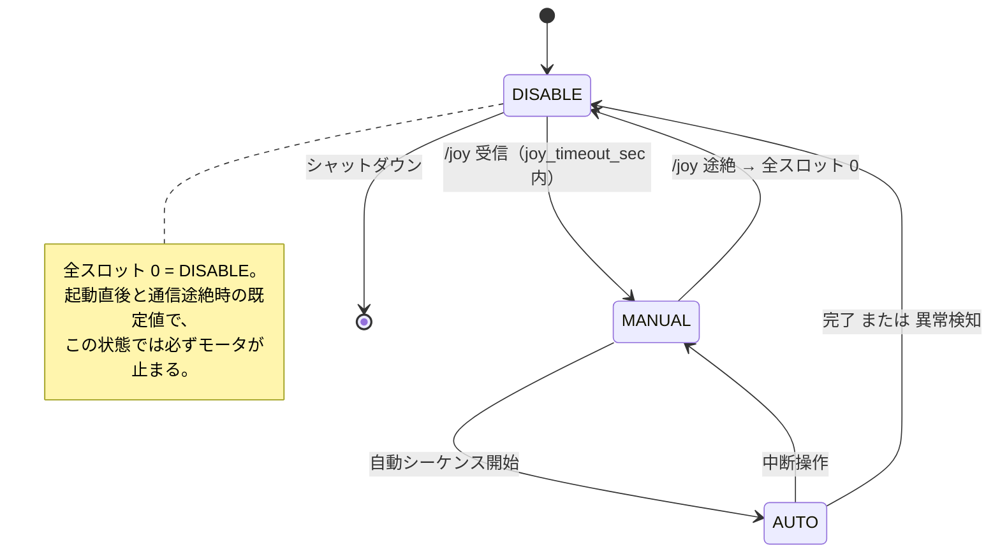
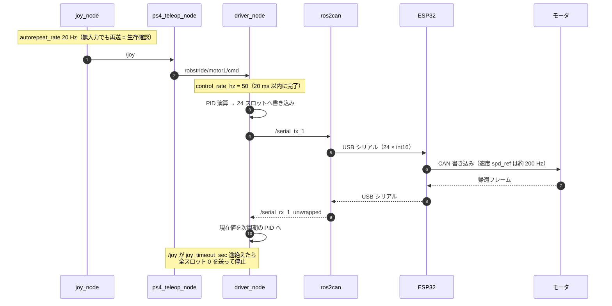

# 桜凰 プログラム構造

関西春ロボコン2027・立命館 桜凰のソフトウェア構成図。
fork 元は [rrst-ros2-ws](https://github.com/RRST-NHK-Project/rrst-ros2-ws)（`sample/rrst-ros2-ws`）。
トピック名・型・周期は fork 元の実装に合わせてあるので、変更したらこの図も直す。

| 項目 | 内容 |
|:---|:---|
| OS / ROS | Ubuntu 24.04 LTS / ROS 2 Jazzy |
| PC ↔ 基板 | `ros2can`（USB シリアル, 24 × int16 フレーム） |
| 基板 ↔ アクチュエータ | CAN 1 Mbps, 29bit 拡張 ID |
| 基板 | SOKI 基板（XIAO ESP32-S3） + 足回り用基盤 |

## 作図規約

| 記法 | 意味 |
|:---|:---|
| 実線矢印 + ラベル | ROS 2 トピック（pub → sub の向き） |
| 破線矢印 | 直接通信しない依存・整合制約 |
| 太矢印 | 物理接続（USB / CAN） |
| `[( )]` | ROS ノードではない物理デバイス |

> **DEVICE_ID と CAN_ID は別物**。`DEVICE_ID` はシリアルフレームの宛先（`serial_tx_<DEVICE_ID>`、ファームの `config.hpp`）、
> `CAN_ID` は CAN バス上の子ノード（101–104）。図中では前者を基板名の横に、後者をアクチュエータの横に書く。

---

## 色分けの凡例

図中のノードは「誰が決めた仕様か」で塗り分けている。

| 色 | 区分 | 意味 | 変えるとどうなるか |
|:---|:---|:---|:---|
| 🟦 青 | **ROS 2 で固定** | ROS 2 Jazzy 本体・標準パッケージ・標準 msg が決めている | 変更できない |
| 🟧 橙 | **fork 元で固定** | `rrst-ros2-ws` / `ros2can` / ファームウェアが決めている | ファームや `ros2can` 側も直さないと通信できない |
| 🟩 緑 | **桜凰で決める** | 自由に設計できる | 影響はこのリポジトリ内に収まる |
| ⬜ 灰 | 物理デバイス | 基板・モータ・コントローラ | 回路図・配線の話 |

### 🟦 ROS 2 で固定されているもの

| 要素 | 根拠 |
|:---|:---|
| `joy_node` とパラメータ `autorepeat_rate` / `deadzone` | ROS 2 公式 `joy` パッケージ |
| トピック名 `joy` | 同パッケージの既定 |
| 型 `sensor_msgs/Joy`, `std_msgs/Int16MultiArray`, `Int32MultiArray`, `Float32MultiArray`, `Float64`, `sensor_msgs/JointState` | ROS 2 標準メッセージ |
| 相対名 / 絶対名の解決ルール、namespace、QoS | ROS 2 の仕様 |
| `ROS_AUTOMATIC_DISCOVERY_RANGE` | ROS 2 Jazzy の環境変数 |
| フレーム名 `map` / `odom` / `base_link` | REP-105 |
| `colcon` / `package.xml` / `CMakeLists.txt` の作法 | ament |

### 🟧 fork 元で固定されているもの

| 要素 | 根拠（fork 元のファイル） |
|:---|:---|
| `serial_tx_<ID>` / `serial_rx_<ID>` / `_unwrapped` / `_zeroed` の名前と型 | `ros2can/ros2can/ros_backend.py` |
| 24 × int16 の固定長フレーム（`DATA_SIZE = 24`） | `common/include/common/Ros2CanPacketController.hpp` |
| `NODE_COUNT = 4` / `SLOTS_PER_NODE = 5` | 同上 ＋ ファーム `config.hpp` ＋ `device_profiles.py` |
| グローバル index の計算式 | 同上 |
| CAN_ID = 101–104 | 同上のコメント |
| 全スロット 0 = DISABLE | `robstride_ctrl/README.md` |
| スロット割り当て（mode_word / target / vel_limit / 帰還の並び） | `robstride_ctrl/include/robstride_ctrl/slot_layout.hpp` |
| `robstride/motorN/cmd` `/state` と `Float32MultiArray` | `robstride_ctrl/src/*.cpp` |
| `common` の PID / PacketController の API | `common/include/common/` |
| `ros2can` を別ターミナルで `--nogui` 起動する運用 | `robstride_ctrl/launch/robstride_ctrl.launch.py` のコメント |
| driver / teleop / monitor の3分割というノード構成パターン | 各 `*_ctrl` パッケージ |

### 🟩 桜凰で決めるもの

| 要素 | 備考 |
|:---|:---|
| パッケージ名と分割（`sakuraou_*`） | 命名規約だけ揃える |
| 足回りの駆動方式・輪数・逆運動学 | **未決定** |
| 足回り用基盤の端子構成 | 自作基板 |
| どのモータを どの CAN_ID / `node_index` / `DEVICE_ID` に割り当てるか | 番号の範囲は橙 |
| 状態機械の状態名と遷移条件 | ただし DISABLE の意味は橙 |
| 制御周期 | 50 Hz は fork 元の既定値であって必須ではない |
| PID ゲイン | 橙のノードの中にある緑の値 |
| ボタン配置 | fork 元も「`ros2 topic echo /joy` で要確認」としている |
| トピック名の先頭スラッシュをどちらに統一するか | fork 元が不統一なので、どちらでも可 |

---

## 1. 全体構成図



### インタフェース定義表

| トピック | 型 | pub | sub | 周期 |
|:---|:---|:---|:---|:---|
| `/joy` | `sensor_msgs/Joy` | `joy_node` | `ps4_teleop_node`, `drive_node` | 20 Hz（無入力でも再送） |
| `robstride/motorN/cmd` | `std_msgs/Float32MultiArray` | `ps4_teleop_node`, `motion_test.py` | `robstride_driver_node` | 都度 |
| `position_command` | `std_msgs/Float64` | `drive_node` | `esc_ctrl_node` | 50 Hz |
| `/serial_tx_<ID>` | `std_msgs/Int16MultiArray`（24要素） | `*_driver_node` | `ros2can` | 50 Hz（20 ms） |
| `/serial_rx_<ID>` | `std_msgs/Int16MultiArray` | `ros2can` | `*_driver_node` | 受信次第 |
| `/serial_rx_<ID>_unwrapped` | `std_msgs/Int32MultiArray` | `ros2can` | `*_driver_node` | 受信次第 |
| `/serial_rx_<ID>_zeroed` | `std_msgs/Int32MultiArray` | `ros2can` | `drive_node` | 受信次第 |
| `robstride/motorN/state` | `std_msgs/Float32MultiArray` | `robstride_driver_node` | `motor_monitor_node` | 受信次第 |
| `cubemars/joint_state` | `sensor_msgs/JointState` | `cubemars_driver_node` | 任意 | 受信次第 |

> **トピック名の先頭スラッシュが fork 元で統一されていない**。`robstride_ctrl` と `ros2can` は相対名（`serial_tx_1`）、
> `esc_ctrl` は絶対名（`/serial_tx_1`）。既定の名前空間では一致するが、ノードに namespace を付けた瞬間に
> 相対名だけが `/<ns>/serial_tx_1` へずれて繋がらなくなる。桜凰では**相対名に統一する**（下の表は既定名前空間での解決後の名前）。

> エンコーダのカウンタは int16 で折り返すため、**位置を使う側は `_unwrapped`（Int32）を購読する**。
> 原点合わせ済みの値が欲しい場合は `_zeroed`。生の `/serial_rx_<ID>` は折り返すので位置制御に使わない。

---

## 2. パッケージ構成図



**原則**

- `common` は header-only。全パッケージが一方向に依存する（逆向きの依存を作らない）。
- `ros2can` とはトピックだけで繋ぐ。`package.xml` に依存を書かない（別リポジトリなので壊れやすい）。
- 自作 msg/srv を作るなら `sakuraou_interfaces` を別パッケージに切り、定義をそこだけに置く。

---

## 3. 足回りのデータフロー



> **`common/common.hpp` は現状インクルードできない**。中で `common/IK.hpp` を include しているが、
> fork 元にそのファイルが存在しない（現在どのパッケージも `common.hpp` を include していないため気付かれていない）。
> 足回りで IK を書くときは、`PID.hpp` などを個別に include するか、`IK.hpp` を自分で用意する。

スロット番号は `グローバル index = node(0 起点) × SLOTS_PER_NODE + local_index`。
ファームの `config.hpp`（`CAN_NODE_COUNT` / `CAN_SLOTS_PER_NODE`）と
`ros2can/device_profiles.py` の `make_can_host_profile()` と**三者を必ず一致させる**。

---

## 4. 状態遷移図



モータ個別の `mode_word`（スロット 0）は `0 = DISABLE / 1 = 速度 / 2 = 位置`。
ロボット全体の状態とモータの mode_word は別物なので、状態機械側で対応表を持つ。

---

## 5. 制御1周期のシーケンス図



---

## 付録 A. 起動時の注意

`ROS_AUTOMATIC_DISCOVERY_RANGE=LOCALHOST` を launch で設定する。
既定（SUBNET）だと同じ Wi-Fi の他 PC のノードと繋がる。
fork 元に「2026-10-15 に他 PC の `joy_node` の `/joy` が混ざり、R1 が押す/離すを繰り返した」記録がある。
**`ros2can` も同じ環境変数を付けて起動する**（別ターミナルで起動するため launch に含まれない）。

```bash
ROS_AUTOMATIC_DISCOVERY_RANGE=LOCALHOST ros2 run ros2can ros2can --nogui
```

## 付録 B. 整合性チェックリスト

図を直したら、以下が食い違っていないか確認する。

- [ ] スロット割り当て: `slot_layout.hpp` ↔ ファーム `config.hpp` ↔ `device_profiles.py`
- [ ] `DEVICE_ID`: driver の param ↔ ファーム `config.hpp` ↔ `ros2can` の追加デバイス
- [ ] `CAN_ID`: ファーム ↔ 実機のモータ設定（ID スキャンのスロット 20–23 で確認可）
- [ ] 位置を扱う箇所が `_unwrapped` / `_zeroed` を購読しているか（生 RX は折り返す）
- [ ] 通信途絶時に全スロット 0 が送られるか

## 付録 C. 命名規約

| 対象 | 規約 | 例 |
|:---|:---|:---|
| パッケージ | `sakuraou_<役割>` / `<アクチュエータ>_ctrl` | `sakuraou_drive`, `robstride_ctrl` |
| ノード | 名詞 + 役割、snake_case | `robstride_driver_node` |
| 指令トピック | `<系統>/<対象>/cmd` | `robstride/motor1/cmd` |
| 状態トピック | `<系統>/<対象>/state` | `robstride/motor1/state` |
| シリアル | `serial_tx_<DEVICE_ID>` / `serial_rx_<DEVICE_ID>` | `serial_tx_202` |
| フレーム | REP-105 に従う | `map`, `odom`, `base_link` |
